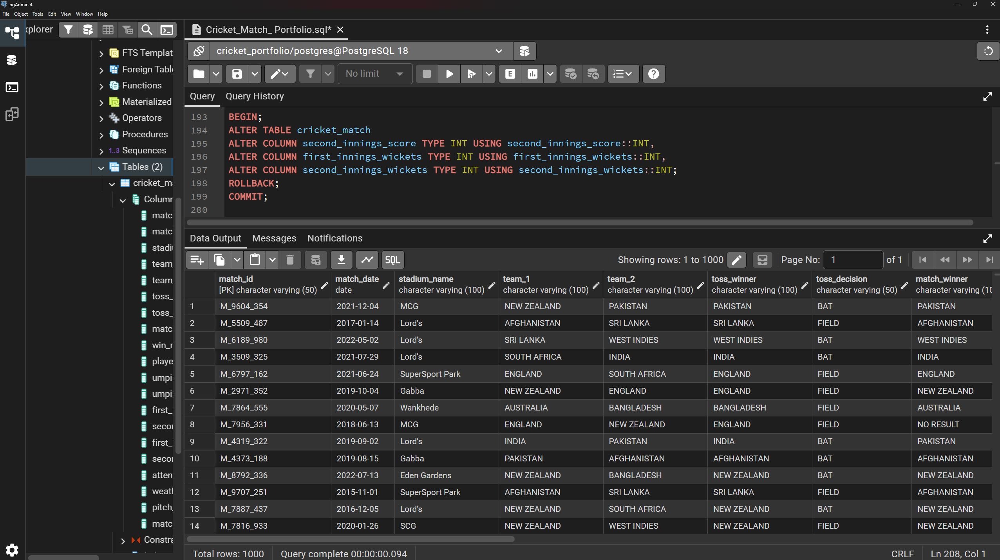
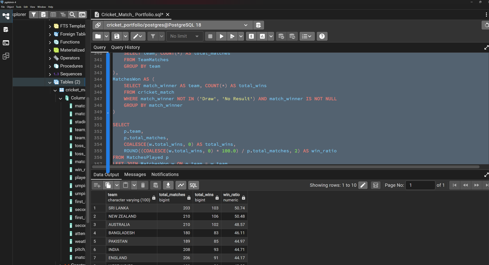
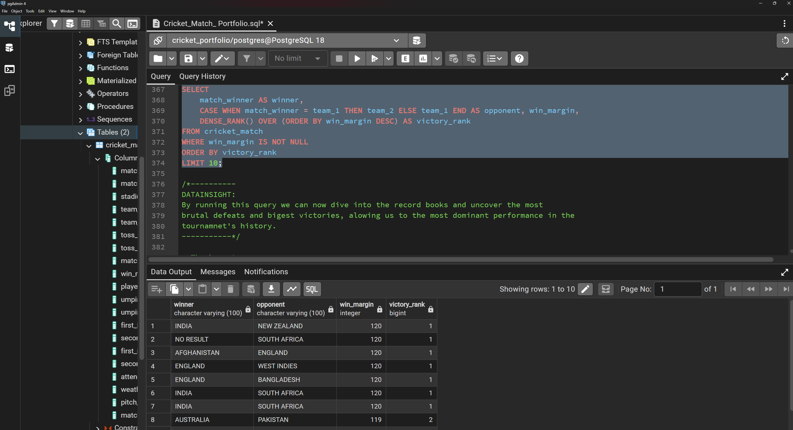

# 🏏 Cricket Match Data Cleaning & EDA (PostgreSQL)

## 📌 Project Overview
This project demonstrates an end-to-end Data Cleaning (ETL) and Exploratory Data Analysis (EDA) process on a Cricket Match dataset using **PostgreSQL (pgAdmin)**. The raw, unstructured dataset was transformed into a clean, relational format to extract meaningful insights about team performances, stadium stats, and match records.

---

## 🧹 Phase 1: Data Cleaning (ETL Process)
The raw data had several quality issues including inconsistent casing, mixed data types, missing values, and anomalies. The following steps were performed using SQL to ensure data integrity:

1. **Primary Key Setup & Duplicate Removal:** Trimmed `match_id` and removed duplicate rows using PostgreSQL's internal `ctid`.
2. **Handling Nulls:** Converted empty strings and literal 'NaN' texts to authentic SQL `NULL`.
3. **Date Formatting:** Standardized mixed date formats (MM/DD/YYYY, DD-MM-YYYY) into SQL `DATE` type using Regex and `CASE` statements.
4. **Text Standardization:** Normalized team names and toss decisions using `UPPER()`, `TRIM()`, and `CASE`.
5. **Data Type Casting & Regex Extraction:** Extracted pure numeric values from string columns (e.g., converting '21 runs' to `21`) using `REGEXP_REPLACE()` and cast them to `INTEGER`.
6. **Data Imputation:** Handled missing/NULL values by replacing them with column averages. Fixed negative match durations using the `ABS()` mathematical function.

### ✨ The "After" View: Fully Cleaned Data
After executing the ETL pipeline, the messy text data was successfully transformed into a clean, strictly-typed analytical format.



*(Cleaned data structure ready for Exploratory Data Analysis)*

---

## 📊 Phase 2: Exploratory Data Analysis & Aggregation
With the data cleaned, several complex SQL queries were written using **CTEs, Window Functions, and Aggregations** to uncover real-world insights.

### 🏆 1. Team Performance Dashboard
**Objective:** Build a comprehensive team performance view showing total matches, wins, and win ratio.
```sql
WITH TeamMatches AS (
	SELECT team_1 AS team FROM cricket_match
	UNION ALL
	SELECT team_2 AS team FROM cricket_match
),
MatchesPlayed AS (
	SELECT team, COUNT(*) AS total_matches
	FROM TeamMatches
	GROUP BY team
),
MatchesWon AS (
	SELECT match_winner AS team, COUNT(*) AS total_wins
	FROM cricket_match
	WHERE match_winner NOT IN ('Draw', 'No Result') AND match_winner IS NOT NULL
	GROUP BY match_winner
)

SELECT
	p.team,
	p.total_matches,
	COALESCE(w.total_wins, 0) AS total_wins,
	ROUND((COALESCE(w.total_wins, 0) * 100.0) / p.total_matches, 2) AS win_ratio
FROM MatchesPlayed p
LEFT JOIN MatchesWon w ON p.team = w.team
ORDER BY win_ratio DESC;
```

Data Insight: We are able to see a clear leaderboard with total matches, total wins, and win ratio, highlighting the most consistent performing teams.



🥇 2. Biggest Victories
Objective: Rank the top 10 largest victories using window functions.

```SQL
SELECT
	match_winner AS winner,
	CASE WHEN match_winner = team_1 THEN team_2 ELSE team_1 END AS opponent, win_margin,
	DENSE_RANK() OVER (ORDER BY win_margin DESC) AS victory_rank
FROM cricket_match
WHERE win_margin IS NOT NULL
ORDER BY victory_rank
LIMIT 10;
```

## Data Insight: 
By running this query we can now dive into the record books and uncover the most brutal defeats and biggest victories, allowing us to see the most dominant performances in the tournament's history.



## Other Key Insights Explored
Venue Statistics: Analyzed average first innings scores and crowd attendance. The Gabba recorded the highest average first innings score (484), while SCG recorded the highest average attendance (51,717).

Toss Impact: Discovered that teams chose to BAT more frequently (552 times) than to FIELD (448 times) after winning the toss.

Close Encounters: Identified thrilling run chases where the team batting second won despite losing 8 or more wickets (mostly occurring at SCG and MCG).

Umpire Workload: Utilized UNION ALL to find the most active and reliable umpires (e.g., Aleem Dar, Simon Taufel).

## Conclusion
This project showcases strong proficiency in PostgreSQL, encompassing data extraction, cleaning (ETL), and advanced querying (CTEs, Window Functions, and Subqueries). It demonstrates how raw, unreliable text files can be systematically transformed into an analytical database to drive actionable insights.
